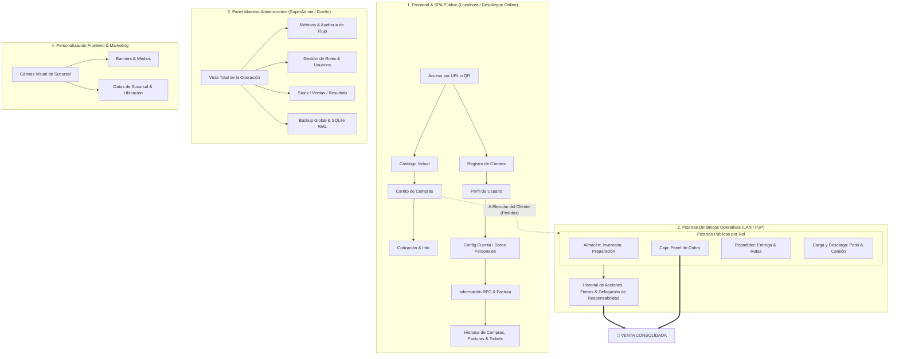

# Mapa de Arquitectura Operativa — BUNKKER E.C.O.S.

Basado en la arquitectura original del sistema (Open Shop Virtual & ERP Local-First).

### Invariantes Clave del Diagrama:
1. **Convergencia en la VENTA:** Todo el flujo del cliente, carrito, preparación de almacén, cobro de caja y entrega converge en la **VENTA**.
2. **Cero Módulos Dev en Producción:** Las herramientas de ingeniería o testing (`/dashboard/tests`) no forman parte de este flujo operativo y viven exclusivamente en la suite CLI/CI.
