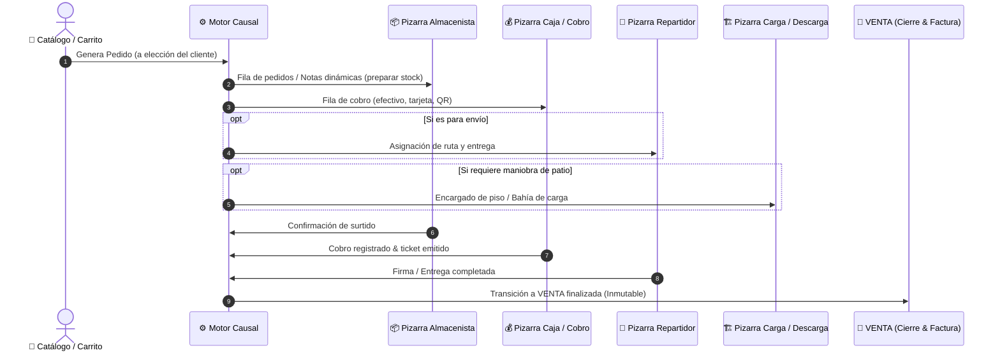

# Hipótesis Arquitectónica 001: Despacho Causal en 4 Pizarras Operativas

## Origen
Derivado del mapa de arquitectura físico dibujado a mano por el usuario (`.agents/manifesto/system-architecture-map.md`).

## Hipótesis
El sistema operativo de BUNKKER no es un simple CRUD, sino un orquestador de acciones físicas entre 4 pizarras operativas sincronizadas en tiempo real:

## Validación Requerida
Cada botón en la interfaz debe estar vinculado directamente a este flujo:
1. Ninguna acción en la pizarra de almacén debe ejecutarse sin actualizar la disponibilidad para caja.
2. Ningún cobro en caja debe finalizarse sin emitir ticket y registrar auditoría del cajero.
3. El estado de la orden debe transicionar en `OrderEvent` de manera append-only (idempotente).
