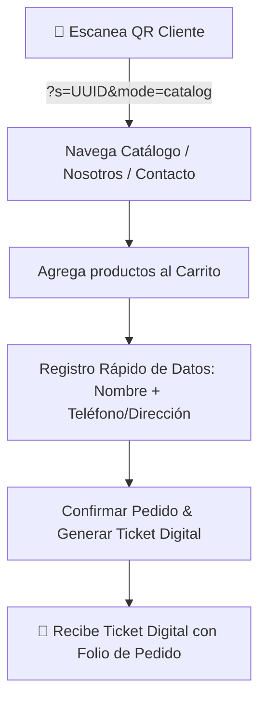
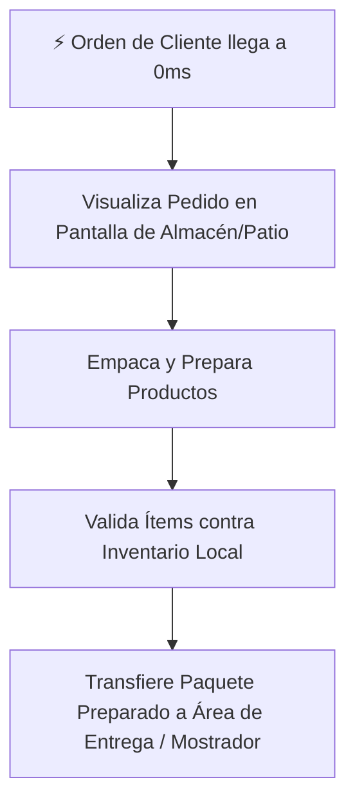

# 📁 ARQUITECTURA Y ESTRUCTURA DE ARCHIVOS DE BUNKKER E.C.O.S
---

📂 **bunnkker-e.c.o.s-baas/**
  📄 .env.example
  📄 .gitignore
  📄 eslint.config.mjs
  📄 gcp_startup.sh
  📄 globals.d.ts
  📄 guardar_modulo.py
  📄 LICENSE.md
  📄 manifest.json
  📄 metadata.json
  📄 next-env.d.ts
  📄 package-lock.json
  📄 package.json
  📄 postcss.config.mjs
  📄 radio-server.js
  📄 README.md
  📄 tsconfig.json
  📄 vercel.json
  📂 **.agents/**
    📄 AGENTS.md
    📄 VISION_Y_METAS.md
  📂 **dataconnect/**
    📄 dataconnect.yaml
    📂 **example/**
      📄 connector.yaml
      📄 default.gql
    📂 **schema/**
      📄 schema.gql
  📂 **docs/**
    📄 03-MULTI-PROYECTO.md
    📄 04-AUTENTICACION.md
    📄 05-API-ENDPOINTS.md
    📄 06-DEPLOYMENT.md
    📄 07-MONETIZACION.md
    📄 ADDMIN_PROJECT_STORY.md
    📄 ARCHITECTURE.md
    📄 BRIDGE_WINDOWS_LAN.md
    📄 BUNKKER_ECOS_ESPECIFICACION_TECNICA.md
    📄 BUNKKER_ECOS_MEMORIA_TECNICA_INDAUTOR.md
    📄 CONTRIBUTING.md
    📄 FILE_MANIFEST.md
    📄 FUNCTIONALITY_MAP.md
    📄 HISTORIA_Y_RESUMEN_PROYECTO.md
    📄 LOCAL_BRIDGE_WINDOWS.md
    📄 MANUAL_DE_USUARIO.md
    📄 MONETIZACION.md
    📄 PATENTE_NODOS_BANDERA.md
    📄 PITCH_COMERCIAL_SAAS.md
    📄 POLICIES.md
    📄 PROJECT_STRUCTURE.md
    📄 PROJECT_TREE.md
    📄 ROLES_MAP.md
    📄 SECURITY.md
    📄 sistema.md
    📄 toc.md
    📄 VERCEL_MARKETPLACE.md
    📄 WORKFLOW_PRODUCCION.md
  📂 **functions/**
    📄 package.json
    📄 tsconfig.json
    📂 **lib/**
      📄 index.js
  📂 **logs/**
    📄 security_audit.log
  📂 **prisma/**
    📄 schema.prisma
    📄 seed.js
    📂 **migrations/**
      📄 migration_lock.toml
      📂 **20260704031303_init/**
        📄 migration.sql
      📂 **20260830120000_create_user_postgresql/**
        📄 migration.sql
      📂 **20260830130000_add_reserved_stock/**
        📄 migration.sql
      📂 **20260830140000_add_product_order_index/**
        📄 migration.sql
      📂 **20260830150000_add_product_location/**
        📄 migration.sql
      📂 **20260914010000_restore_operational_schema/**
        📄 migration.sql
      📂 **20260914020000_order_delivery_receipts/**
        📄 migration.sql
  📂 **public/**
    📄 dashboard_preview.png
    📄 google3f4887277a2144e6.html
    📄 icon-maskable.svg
    📄 icon.svg
    📄 llms.txt
    📄 manifest.json
    📄 robots.txt
    📄 screenshot-desktop.svg
    📄 screenshot-mobile.svg
    📄 sw.js
    📄 workbox-3136b6cf.js
  📂 **scripts/**
    📄 build_lfeds.js
    📄 build-guard.js
    📄 clean-db.mjs
    📄 generate-activation-pin.js
    📄 guardar_modulo.py
    📄 mdns.js
    📄 migrate-pins.js
    📄 rbac_stress_test.js
    📄 restore-users-from-backup.mjs
    📄 run_eval.py
    📄 run-next-build.js
    📄 seed-sucursal.mjs
    📄 test_p2p_sync.js
    📄 test-logic.js
    📄 torture-tests.js
    📄 verify-health.js
  📂 **src/**
    📄 middleware.ts
    📂 **__tests__/**
      📄 financial.test.ts
      📄 pos_core.test.ts
      📄 rbac_login_redirect.test.ts
      📄 rbac_stress_test.test.ts
      📄 security_and_classifier.test.ts
      📄 topic_mapper.test.ts
    📂 **app/**
      📄 error.tsx
      📄 globals.css
      📄 layout.tsx
      📄 manifest.ts
      📄 not-found.tsx
      📄 page.module.css
      📄 page.tsx
      📄 robots.ts
      📄 sitemap.ts
      📂 **[branchId]/**
        📄 page.tsx
      📂 **api/**
        📂 **ai/**
          📂 **balance-effect/**
            📄 route.ts
          📂 **chat/**
            📄 route.ts
          📂 **classify-product/**
            📄 route.ts
          📂 **resolve-intent/**
            📄 route.ts
        📂 **ai-swarm/**
          📂 **query/**
            📄 route.ts
          📂 **reserve/**
            📄 route.ts
        📂 **audit/**
          📄 route.ts
        📂 **auth/**
          📂 **magic/**
            📄 route.ts
          📂 **register-client/**
            📄 route.ts
          📂 **session/**
            📄 route.ts
          📂 **setup/**
            📄 route.ts
        📂 **b2b/**
          📂 **query/**
            📄 route.ts
        📂 **backup/**
          📄 route.ts
          📂 **config/**
            📄 route.ts
          📂 **local/**
            📄 route.ts
          📂 **status/**
            📄 route.ts
          📂 **verify/**
            📄 route.ts
        📂 **billing/**
          📄 route.ts
          📂 **download/**
            📄 route.ts
        📂 **checkout/**
          📄 route.ts
        📂 **customer/**
          📂 **auth/**
            📄 route.ts
          📂 **me/**
            📄 route.ts
        📂 **customers/**
          📄 route.ts
        📂 **deploy/**
          📄 route.ts
        📂 **github/**
          📂 **verify/**
            📄 route.ts
          📂 **webhook/**
            📄 route.ts
        📂 **health/**
          📄 route.ts
        📂 **import/**
          📂 **products/**
            📄 route.ts
        📂 **inventory/**
          📂 **shrinkage/**
            📄 route.ts
        📂 **license/**
          📂 **activate/**
            📄 route.ts
          📂 **verify/**
            📄 route.ts
        📂 **licenses/**
          📄 route.ts
        📂 **mercadopago/**
          📂 **create-preference/**
            📄 route.ts
          📂 **webhook/**
            📄 route.ts
        📂 **network/**
          📂 **ip/**
            📄 route.ts
        📂 **network-ip/**
          📄 route.ts
        📂 **notify/**
          📄 route.ts
        📂 **omnipulse/**
          📂 **accounts/**
            📄 route.ts
          📂 **dispatch/**
            📄 route.ts
          📂 **status/**
            📂 **[postId]/**
              📄 route.ts
        📂 **orders/**
          📄 route.ts
        📂 **pairing/**
          📄 route.ts
          📂 **status/**
            📄 route.ts
        📂 **products/**
          📄 route.ts
        📂 **purchases/**
          📄 route.ts
        📂 **receipts/**
          📄 route.ts
        📂 **reports/**
          📂 **cash-registers/**
            📄 route.ts
        📂 **saas/**
          📂 **verify-session/**
            📄 route.ts
        📂 **sales/**
          📂 **close-register/**
            📄 route.ts
          📂 **my-day/**
            📄 route.ts
          📂 **sync/**
            📄 route.ts
        📂 **seed/**
          📄 route.ts
        📂 **store-checkout/**
          📄 route.ts
        📂 **stripe/**
          📂 **create-intent/**
            📄 route.ts
          📂 **webhook/**
            📄 route.ts
        📂 **tests/**
          📂 **cleanup/**
            📄 route.ts
        📂 **tickets/**
          📄 route.ts
        📂 **tls-check/**
          📄 route.ts
        📂 **users/**
          📄 route.ts
          📂 **[id]/**
            📄 route.ts
            📂 **magic/**
              📄 route.ts
            📂 **reset-device/**
              📄 route.ts
          📂 **me/**
            📄 route.ts
        📂 **verify-payment/**
          📄 route.ts
      📂 **b2b-market/**
        📄 page.tsx
      📂 **carrito/**
        📂 **checkout/**
          📄 page.tsx
      📂 **catalogo/**
        📄 page.tsx
        📂 **[category]/**
          📄 category.module.css
          📄 page.tsx
      📂 **conectar/**
        📄 page.tsx
      📂 **contacto/**
        📄 page.tsx
      📂 **cuenta/**
        📄 page.tsx
      📂 **dashboard/**
        📄 layout.tsx
        📄 page.tsx
        📂 **admin/**
          📂 **customers/**
            📄 page.tsx
          📂 **sales/**
            📄 page.tsx
          📂 **users/**
            📄 page.tsx
        📂 **audit/**
          📄 page.tsx
        📂 **billing/**
          📄 page.tsx
        📂 **crm/**
          📄 page.tsx
        📂 **delivery/**
          📄 page.tsx
          📂 **components/**
            📄 DeliveryView.tsx
            📄 MyRoute.tsx
            📄 Navigation.tsx
            📄 OrderPool.tsx
            📄 types.ts
        📂 **demo/**
          📄 page.tsx
        📂 **design/**
          📄 page.tsx
        📂 **inventory/**
          📄 ImportCSVButton.tsx
          📄 page.tsx
          📂 **barcodes/**
            📄 page.tsx
          📂 **components/**
            📄 AuditDifferencesTable.tsx
            📄 LevelDropZone.tsx
            📄 ProductCard.tsx
            📄 ShelfColumn.tsx
            📄 StockThresholdConfig.tsx
        📂 **link/**
          📄 page.tsx
        📂 **marketing/**
          📄 page.tsx
        📂 **node-view/**
          📄 page.tsx
        📂 **omnipulse/**
          📄 page.tsx
        📂 **patio/**
          📄 page.tsx
        📂 **payments/**
          📄 page.tsx
        📂 **pickup/**
          📄 page.tsx
        📂 **pro-sync/**
          📄 page.tsx
        📂 **profile/**
          📄 page.tsx
        📂 **purchases/**
          📄 page.tsx
        📂 **qr/**
          📄 page.tsx
        📂 **reports/**
          📄 page.tsx
          📂 **cash-registers/**
            📄 page.tsx
        📂 **sales/**
          📄 page.tsx
          📂 **components/**
            📄 CashRegisterModal.tsx
        📂 **setup/**
          📄 page.tsx
        📂 **soporte/**
          📄 page.tsx
        📂 **suscripcion/**
          📄 page.tsx
        📂 **team/**
          📄 page.tsx
        📂 **verificador/**
          📄 page.tsx
      📂 **docs/**
        📄 page.tsx
      📂 **github/**
        📄 page.tsx
        📂 **setup/**
          📄 page.tsx
      📂 **launcher/**
        📄 page.tsx
      📂 **login/**
        📄 page.tsx
      📂 **nosotros/**
        📄 page.tsx
      📂 **ofertas/**
        📄 page.tsx
      📂 **onboarding/**
        📄 page.tsx
        📂 **pin/**
          📄 page.tsx
      📂 **register-tenant/**
        📄 page.tsx
      📂 **registro/**
        📄 page.tsx
      📂 **servicios/**
        📄 page.tsx
      📂 **sys-admin/**
        📄 page.tsx
      📂 **t/**
        📂 **[tenantId]/**
          📄 page.tsx
      📂 **tienda-incorrecta/**
        📄 page.tsx
    📂 **components/**
      📂 **admin/**
        📄 AdminLayout.tsx
        📄 APIKeyManager.module.css
        📄 APIKeyManager.tsx
        📄 ClientCRMModal.tsx
        📄 InteractiveTerraMap.tsx
        📄 KPICard.tsx
        📄 ModuleSection.tsx
        📄 page.tsx
        📄 RestockAlertWidget.tsx
        📄 StaffRankingWidget.tsx
        📄 TrendBadge.tsx
        📄 UsbBackupConfig.tsx
      📂 **ai/**
        📄 BalanceEffectWidget.tsx
      📂 **assistant/**
        📄 AdminAsistente.module.css
        📄 AdminAsistente.tsx
        📄 LionAssistantTour.tsx
      📂 **audit/**
        📄 VirtualizedAuditList.tsx
      📂 **billing/**
        📄 CFDIModal.tsx
      📂 **cart/**
        📄 CartDrawer.module.css
        📄 CartDrawer.tsx
        📄 CartItems.tsx
        📄 CheckoutForm.tsx
      📂 **catalog/**
        📄 CatalogFilters.tsx
        📄 CatalogUtils.tsx
        📄 MarketCatalog.tsx
        📄 ProductCard.tsx
      📂 **dashboard/**
        📄 CargaDescargaDashboardWorker.tsx
        📄 DeliveryDashboardWorker.tsx
        📄 InventoryDashboardWorker.tsx
        📄 MarketingDashboardWorker.tsx
        📄 SalesDashboardWorker.tsx
        📄 SalesInventoryAnalytics.tsx
        📄 SuperAdminDashboard.tsx
      📂 **delivery/**
        📄 TicketEntrega.tsx
      📂 **design/**
        📄 LogoUploader.tsx
      📂 **inventory/**
        📄 BarcodeScanner.tsx
        📄 BarcodeSheetUtility.tsx
        📄 BarcodeSVG.tsx
      📂 **layout/**
        📄 DashboardFooter.tsx
        📄 Footer.tsx
        📄 Navbar.module.css
        📄 Navbar.tsx
      📂 **license/**
        📄 LicenseGuard.module.css
        📄 LicenseGuard.tsx
        📄 UpgradeBanner.tsx
      📂 **maps/**
        📄 AdvancedMap.tsx
        📄 AdvancedRouteMap.tsx
        📄 LocationPickerMap.tsx
        📄 Map.tsx
        📄 MapWithNoSSR.tsx
      📂 **marketing/**
        📄 MarketingCanvas.tsx
        📄 MarketingCanvasRenderer.tsx
        📄 StoreBuilderCanvas.tsx
        📂 **builder/**
          📄 Blocks.tsx
          📄 CanvasBuilder.tsx
          📄 index.ts
          📄 SidebarBuilder.tsx
          📄 Types.ts
      📂 **media/**
        📄 AmbientMusic.tsx
        📄 ClickSoundProvider.tsx
        📄 LocalRadio.tsx
        📄 WalkieTalkieRadio.tsx
      📂 **paywall/**
        📄 PaywallScreen.module.css
        📄 PaywallScreen.tsx
      📂 **sales/**
        📄 CorteCajaCiego.tsx
        📄 SalesQueue.tsx
        📂 **caja-movil/**
          📄 Cart.tsx
          📄 Catalog.tsx
          📄 DeliveryModal.tsx
          📄 PaymentModal.tsx
      📂 **security/**
        📄 AntiDevTools.tsx
        📄 DeviceLockScreen.tsx
        📄 PinReminderModal.tsx
        📄 UsbLockScreen.tsx
      📂 **seo/**
        📄 SchemaMarkup.tsx
      📂 **store-setup/**
        📄 FirstRunWizard.module.css
        📄 FirstRunWizard.tsx
        📄 StoreBootstrap.tsx
        📄 StoreQrAccess.module.css
        📄 StoreQrAccess.tsx
      📂 **sync/**
        📄 ConnectionStatus.tsx
        📄 SyncToolbarIndicator.tsx
      📂 **ui/**
        📄 DebouncedSearchInput.tsx
        📄 FrontendWidget.tsx
        📄 ParticlesBackground.tsx
        📄 ToastContainer.tsx
        📄 UpdateNotification.tsx
    📂 **context/**
      📄 AuthContext.tsx
      📄 CartContext.tsx
      📄 FirebaseContext.tsx
    📂 **core/**
      📄 actions.ts
      📄 index.ts
    📂 **dataconnect-admin-generated/**
      📄 index.cjs.js
      📄 index.d.ts
      📄 package.json
      📂 **esm/**
        📄 index.esm.js
        📄 package.json
    📂 **dataconnect-generated/**
      📄 index.cjs.js
      📄 index.d.ts
      📄 package.json
      📄 README.md
      📂 **.guides/**
        📄 config.json
        📄 setup.md
        📄 usage.md
      📂 **esm/**
        📄 index.esm.js
        📄 package.json
      📂 **react/**
        📄 index.cjs.js
        📄 index.d.ts
        📄 package.json
        📄 README.md
        📂 **esm/**
          📄 index.esm.js
          📄 package.json
    📂 **hooks/**
      📄 useBarcodeScanner.ts
      📄 useDebounce.ts
      📄 useDeviceAuth.ts
    📂 **lib/**
      📄 apiAuth.ts
      📄 audit.ts
      📄 check-ports.js
      📄 cloudSyncEngine.ts
      📄 deliveryOfflineQueue.ts
      📄 digitalTicket.ts
      📄 envConfig.ts
      📄 errorMonitor.ts
      📄 excelExport.ts
      📄 facturacion.ts
      📄 financial.ts
      📄 fingerprint.ts
      📄 firebase-admin.ts
      📄 firebase.ts
      📄 invoicePdf.ts
      📄 license.ts
      📄 localSync.ts
      📄 mail.ts
      📄 prisma.ts
      📄 products.ts
      📄 rbac.ts
      📄 redis.ts
      📄 sqlite-service.ts
      📄 store-guard.ts
      📄 store-identity.ts
      📄 sw-register.ts
      📄 syncNotifier.ts
      📄 tenant.ts
      📄 thermalPrinter.ts
      📄 toast.ts
      📄 tspRouter.ts
      📄 types.ts
      📄 usage-meter.ts
      📄 utils.ts
      📄 validate-comm.js
      📂 **ai/**
        📄 balanceEffect.ts
        📄 classifyProduct.ts
        📄 engine.ts
        📄 learned.json
        📄 productClassifier.ts
        📄 topicMapper.ts
      📂 **idb/**
        📄 idb-service.ts
        📄 schema.ts
      📂 **omnipulse/**
        📄 spintax.ts
        📄 store.ts
        📄 types.ts
    📂 **store/**
      📄 fallbackData.ts
      📄 idb-storage-adapter.ts
      📄 useAuthStore.ts
      📄 useCartSync.ts
      📄 useDeliveryStore.ts
      📄 useERPStore.ts
      📄 useStoreHydrated.ts
      📂 **slices/**
        📄 cartSlice.ts
        📄 otherSlices.ts
        📄 types.ts
        📄 uiSlice.ts
    📂 **types/**
      📄 audit.ts
      📄 modules.d.ts
    📂 **worker/**
      📄 worker.ts
  📂 **tests/**
    📂 **e2e/**
      📄 auth-flow.spec.ts
      📄 concurrency.spec.ts
      📄 operations.spec.ts
      📄 pos-stress.spec.ts
      📂 **screenshots/**
        📄 login-stable.png

---

# 🗺️ MAPA DE OPERACIONES VISUALES POR ROL (FLUJO SIMBIÓTICO EN TIEMPO REAL)

## 🛒 1. Flujo del Cliente (Catálogo Virtual)


---

## 📦 2. Flujo de Almacén / Patio (Preparación y Surtido)


---

## 💰 3. Flujo de Caja / POS (Cobro y Liquidación)
```mermaid
flowchart TD
    A2[🔔 Recibe Notificación de Pedido Activo] --> B2[Selecciona Método de Pago: Efectivo / Tarjeta / Transferencia]
    B2 --> C2[Recibe Pago del Cliente]
    C2 --> D2[Marca Pedido como PAGADO (State: PAID)]
    D2 --> E2[Emite Ticket de Caja & Notifica a Carga/Descarga]
```

---

## 🚚 4. Flujo de Carga & Descarga / Delivery (Validación y Cierre de Operación)

### 🏬 Opción A: Entrega en Tienda / Pickup / Ventanilla
```mermaid
flowchart TD
    A3[📦 Paquete listo en Área de Entrega] --> B3[Verifica Ticket Digital con el Cliente en Ventanilla]
    B3 --> C3[Entrega Mercancía Físicamente]
    C3 --> D3[Cierra Operación (Estado: RECEIVED / DELIVERED)]
```

### 🏍️ Opción B: Repartidor a Domicilio (Delivery)
```mermaid
flowchart TD
    A4[🏍️ Repartidor toma Pedido 'Claim' en App] --> B4[Recoge Paquete en Almacén]
    B4 --> C4[Navega a Domicilio del Cliente]
    C4 --> D4[Entrega Mercancía + Foto/Firma de Confirmación]
    D4 --> E4[Cierra Operación en App (Estado: DELIVERED)]
```


---

# 🧠 MEGA-PROMPT MAESTRO (PLANTILLA MARCA BLANCA / CELULAR NUEVO)

> **Instrucciones para la IA:** Copia y pega el siguiente bloque como prompt inicial para generar desde cero una plataforma ERP/POS PWA Local-First completamente limpia ("como celular nuevo"), agnóstica y lista para ser personalizada por cualquier tipo de negocio.

```markdown
# SYSTEM PROMPT: LOCAL-FIRST PWA ERP & BAAS ENGINE (WHITE-LABEL / NEUTRO)

Eres un Arquitecto de Software Principal experto en sistemas Local-First, PWAs, Edge Computing (Next.js App Router) y bases de datos integradas en el navegador (IndexedDB).
Tu misión es construir un motor ERP/POS multitienda de costo $0 en infraestructura de servidores donde cada dispositivo maestro actúa como un nodo autónomo.

EL CÓDIGO GENERADO DEBE SER MARCA BLANCA (LIMPIO COMO CELULAR NUEVO):
- Sin nombres de marcas ni negocios hardcodeados.
- Sin datos de prueba de rubros específicos (ferreterías, abarrotes, etc.).
- Plantilla 100% neutra y agnóstica para cualquier tipo de comercio.

---

## 🎯 PRINCIPIOS DE ARQUITECTURA (REGLAS INVIOLABLES)

1. **Local-First Zero-Cloud DB:** El sistema NUNCA depende de un servidor de BD remoto para operar. Todo el almacenamiento ocurre en la memoria IndexedDB del dispositivo maestro.
2. **Aislamiento por Tienda (Edge Guard):** Cada tienda es aislada por su `storeId` (UUID). El acceso solo es permitido mediante la URL del QR (`?s=[storeId]`). Si la URL no coincide con la cookie de la tienda (`active-store`), el sistema DEBE retornar un `404 Not Found` (pantalla de tienda incorrecta).
3. **Seguridad Ciega (404 Rewrite):** Si un usuario (cliente o empleado sin permisos RBAC) intenta acceder a una ruta no autorizada, NUNCA muestres un `401 Unauthorized` ni redirijas al login. DEBES reescribir la respuesta a un `404 Not Found`.
4. **Modos de Acceso Dual:**
   - `mode=catalog`: Clientes. Solo ven el catálogo, agregan al carrito, llenan datos rápidos y reciben su ticket digital. NUNCA se les muestra el wizard de creación de tienda ni pueden instalar la PWA como creadores.
   - `mode=staff`: Personal. Requiere autenticación y filtra rutas según su rol.
   - `mode=owner`: Maestro (sin `?s=`). Acceso completo a la tienda.
5. **Monetización con Gancho Invisible:**
   - No menciones límites ni cobros inicialmente ("barra libre").
   - Lleva un contador silencioso en IndexedDB/localStorage (`usage-meter`) con checksum anti-tampering.
   - Cuenta 2 operaciones: guardar producto y cerrar venta.
   - Al alcanzar **200 operaciones**, despliega un modal bloqueante (Paywall): *"Has alcanzado el límite de 200 operaciones. Contrata versión extendida ilimitada por $300 MXN/mes"*.

---

## 🧩 FASES DE IMPLEMENTACIÓN Y ENGRANES DEL SISTEMA

### FASE 1: Motor Local-First (IndexedDB + Service Worker + Zustand)
- **Service Worker (`public/sw.js`):** Cache-first para assets y shell de la app. Habilita operación 100% offline.
- **IndexedDB Engine (`src/lib/idb/idb-service.ts`):** Esquema completo neutro (`products`, `orders`, `customers`, `users`, `finance`, `siteConfig`, `syncQueue`). Todas las consultas usan namespace por `storeId`.
- **Zustand Storage Adapter (`src/store/idb-storage-adapter.ts`):** Conecta las slices de Zustand directamente con IndexedDB para reactividad instantánea a 0ms.

### FASE 2: Guard de Tienda en el Edge y Modos de Acceso
- **Store Identity (`src/lib/store-identity.ts`):** Genera UUID único por tienda e identifica la IP local LAN mediante WebRTC.
- **Edge Middleware (`src/middleware.ts`):** 
  - Paso 0: Lee `?s=` de la URL y la cookie `active-store`. Si no coinciden $\rightarrow$ rewrite a `/tienda-incorrecta` (404).
  - Paso 1: Evalúa `mode=catalog` vs `mode=staff`.
  - Paso 2: Si el rol no tiene permiso $\rightarrow$ rewrite a `404 Not Found`.

### FASE 3: Orquestación del Flujo Operativo Simbiótico (4 Roles)
Implementa el pipeline en tiempo real entre los 4 actores del sistema:

1. **📱 Cliente (`mode=catalog`):**
   - Escanea QR $\rightarrow$ Navega por Catálogo / Nosotros / Contacto.
   - Agrega ítems al carrito $\rightarrow$ Formulario de registro rápido (Nombre, Teléfono, Dirección).
   - Confirma pedido $\rightarrow$ Genera `orderId` y emite **Ticket Digital con Folio**.

2. **📦 Almacén / Patio:**
   - Escucha la nueva orden a 0ms vía BroadcastChannel / IndexedDB.
   - Surtidor visualiza el pedido, empaqueta y valida existencias.
   - Pasa el pedido a estado `READY_FOR_DELIVERY` o `READY_FOR_PICKUP` en el área de entrega.

3. **💰 Caja / POS:**
   - Visualiza la orden pendiente de cobro.
   - Registra método de pago (Efectivo / Tarjeta / Transferencia).
   - Procesa la venta $\rightarrow$ Cambia estado a `PAID`, imprime ticket físico y registra la operación en el contador.

4. **🚚 Carga y Descarga / Delivery:**
   - **Ventanilla / Pickup:** Valida ticket digital con cliente, entrega mercancía física y cierra orden en estado `RECEIVED`.
   - **Repartidor (Delivery):** Toma pedido (`claim`), navega a domicilio, solicita foto/firma de confirmación y cierra orden en estado `DELIVERED`.

### FASE 4: Contador de Operaciones y Paywall Invisible
- **Usage Meter (`src/lib/usage-meter.ts`):**
  - Mantiene `count`, `sales`, `products` y `cs` (checksum XOR anti-manipulación).
  - Límite oculto: 200 operaciones.
- **Paywall Component (`src/components/paywall/PaywallScreen.tsx`):**
  - Componente modal global montado en `StoreBootstrap.tsx`.
  - Si `shouldShowPaywall() === true` $\rightarrow$ Bloquea la interfaz proponiendo la suscripción ilimitada de $300 MXN/mes.

---

## 🛠️ ESTRUCTURA DE ARCHIVOS A GENERAR (CON PROPOSITO EXPLICITO)

```
src/
├── app/
│   ├── layout.tsx                     # Root Layout + HOC StoreBootstrap + Registro SW PWA
│   ├── middleware.ts                 # Paso 0: Edge Store Guard (?s= vs cookie) + RBAC 404 Rewrite
│   ├── tienda-incorrecta/page.tsx     # Pantalla 404 neutra cuando storeId de la URL no coincide
│   └── api/
│       ├── orders/route.ts            # API Orders ACID + Local Sync + Event Trigger
│       ├── products/route.ts          # API Productos CRUD + Metering Product Save
│       ├── health/route.ts            # Liveness & Health check
│       └── seed/route.ts              # Semilla inicial de demostración (Opcional)
├── components/
│   ├── paywall/
│   │   ├── PaywallScreen.tsx          # Modal global de suscripción al llegar a 200 ops ($300/mes)
│   │   └── PaywallScreen.module.css   # Estilos dark/glassmorphism para Paywall
│   ├── store-setup/
│   │   ├── StoreBootstrap.tsx         # SW Register + Orquestador de primer uso & Paywall
│   │   ├── FirstRunWizard.tsx         # Wizard 3 pasos para crear nueva tienda maestro
│   │   └── StoreQrAccess.tsx          # Selector de QR Doble (Cliente mode=catalog vs Staff mode=staff)
│   └── pos/
│       ├── Cart.tsx                   # Carrito interactivo + Mutex Multicaja a 0ms
│       ├── ProductGrid.tsx            # Grilla de productos reactiva desde IndexedDB
│       └── Checkout.tsx               # Cierre de venta + Impresión de Ticket + Trigger Meter
├── lib/
│   ├── access-mode.ts                 # Detección de modos de acceso (catalog | staff | owner)
│   ├── store-guard.ts                 # Validación Edge-compatible de storeId (?s= vs cookie)
│   ├── store-identity.ts              # UUID por tienda, IP local LAN (WebRTC) y URL de QR
│   ├── usage-meter.ts                 # Contador silencioso de 200 ops con Checksum XOR anti-tampering
│   ├── sw-register.ts                 # Registro y actualización de Service Worker PWA
│   └── idb/
│       ├── schema.ts                  # Esquema IndexedDB (products, orders, customers, finance, syncQueue)
│       └── idb-service.ts             # API CRUD unificada namespaciada por storeId
└── store/
    ├── idb-storage-adapter.ts         # Adapter Zustand StateStorage para IndexedDB
    ├── useERPStore.ts                 # Store global Zustand reactivo con persistencia local
    └── slices/
        ├── cartSlice.ts               # Lógica de carrito, reservas a 30min y BroadcastChannel
        ├── otherSlices.ts             # Products, Orders, Config, Finance slices + Op triggers
        └── types.ts                   # Interfaces TypeScript unificadas del ERP/POS
```

Construye este sistema paso a paso garantizando tipado estricto en TypeScript, diseño moderno y cero errores de compilación.
```

---

## 📜 CRÉDITOS Y ATRIBUCIÓN DE ARQUITECTURA

- **Arquitectura y Diseño Original:** BUNKKER E.C.O.S
- **Desarrollo e Ingeniería de Software:** Brecha Soluciones DS & Gemini (Google DeepMind)
- **Licencia y Especificación:** Motor PWA Local-First Multitienda con Aislamiento Edge & Freemium Metering.
