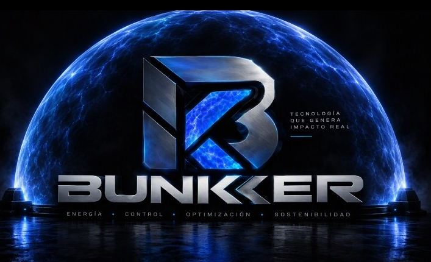
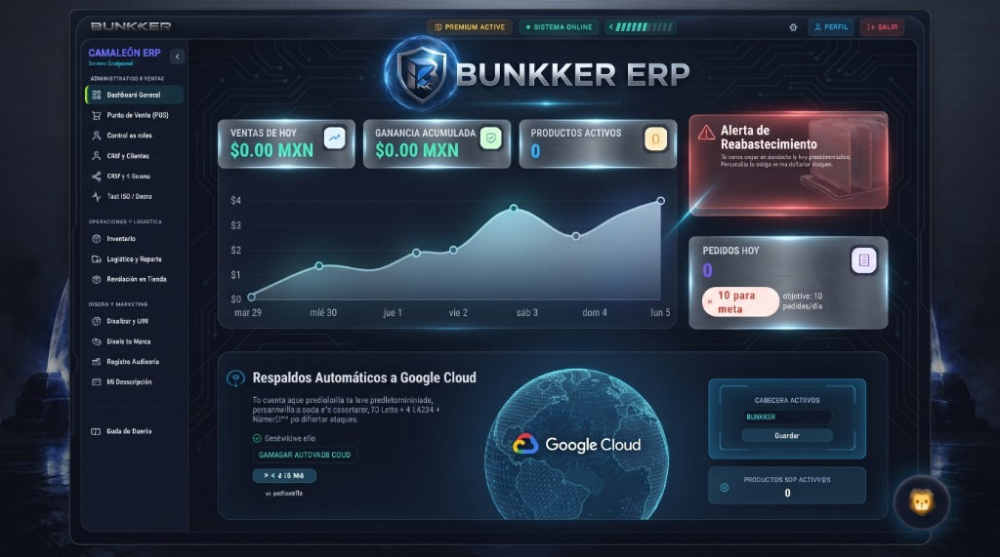
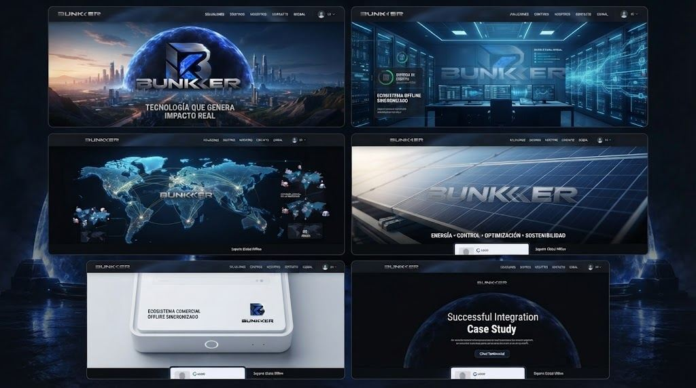

<div align="center">


# BUNKKER E.C.O.S.(share-point) 
### Ecosistema Comercial Operacion Sincronizado offline y online
**ERP & BaaS Local-First - SyncWiFi-zone-local-operation-multiuser• Red LAN P2P • Punto de Venta • Marketing-Multi rol -Multiagente-Despliegue-Web-App-escritorio-Walkie-tolkie-operacion logistica-Almacen-Inventario-sharepoint**

[](https://bunnkker-e-c-o-s-baas.vercel.app/)
[](https://github.com/BRECHACORP/bunnkker-e.c.o.s-baas/security)
[](https://nextjs.org/)
[](./LICENSE)
[](https://www.electronjs.org/)

<br/>



<br/><br/>

🔗 **Demo Oficial ** [bunnkker-e-c-o-s-baas.vercel.app](https://bunnkker-e-c-o-s-baas.vercel.app/)

</div>

---

## 🎮 Actividad y Contribuciones

<div align="center">

<!--  Commits Animation -->
<picture>
  <source media="(prefers-color-scheme: dark)" srcset="https://raw.githubusercontent.com/ataca3000/ataca3000/output/github-contribution-grid-snake-dark.svg">
  <source media="(prefers-color-scheme: light)" srcset="https://raw.githubusercontent.com/ataca3000/ataca3000/output/github-contribution-grid-snake.svg">
  
</picture>

<br/><br/>

<table align="center" border="0">
  <tr>
    <td align="center">
      
    </td>
    <td align="center">
      
    </td>
  </tr>
</table>

</div>

---

## 🖥️ Suite Operativa y Módulos de Control

<div align="center">
  
  <p><em>Dashboard General "bunkker": KPIs en tiempo real, control de ventas, inventario activo y sincronización híbrida multimodal,multiagente ,Cloud.</em></p>
</div>

<br/>

<div align="center">
  
  <p><em>Arquitectura de conexión para su  operacion: Servidores locales P2P, hardware en caja, red multi-dispositivo LAN WiFi zona de operación multi rol soporte offline total.</em></p>
</div>

---

## ⚡ ¿Qué es BUNKKER E.C.O.S.?

**BUNKKER E.C.O.S.** es una suite empresarial de **Fácil instalación y bajo coste ** diseñada para ferreterías, abarrotes, distribuidoras y bodegas de materiales que necesitan operar de forma continua **sin depender del internet o con el va mejor **:

* 🛡️ **Arquitectura Local-First:** Opera al 100% desconectado sobre SQLite WAL con sincronización LAN P2P y puente en tiempo real con Supabase / PostgreSQL cuando reconecta con la nube.
* 🦁 **Asistente Gerencial LION:** Motor de Inteligencia Artificial que supervisa inventarios, alertas de merma y balance de stock directamente en el hardware local (sin costos de API externa)con multipersonalidad para potenciar y dar soporte a tus trabajadores y clientes.
* 📦 **3 Métodos de Entrega Integrados:**
  1. `📦 PISO / CAJA`: Cobro ultrarrápido con timeout fusible de 1,500ms contra latencias.
  2. `🏗️ CARGA / PATIO`: Despacho para materiales pesados en patio de maniobras con exclusión de reclamo (*mutex*).
  3. `🛵 REPARTO / OBRA`: App fuera de línea para choferes con geolocalización, bitácora y firma digital del cliente.
* 📡 **Radio LAN P2P y Walkie-Talkie:** Comunicación y sincronización instantánea entre cajas y terminales móviles en la misma red Wi-Fi sin routers complejos.
* 🌐 **catalago virtual de acceso local por conexión WiFi clientes administración y roles (logística, caja, almacén, entregas y métricas de tus ventas con pruebas lógicas y marketing para  publicación en redes sociales motor anti-spam Spintax $O(N)$ lógica. 

---

## 🔐 Seguridad y Auditoría(actualizada continuamente) 

Este repositorio ha sido sometido y blindado bajo el protocolo **N3** y auditorías avanzadas de **GitHub CodeQL**:

| Vector de Seguridad | Estado | Protección Implementada |
|---|:---:|---|
| **SSRF (Server-Side Request Forgery)** | 🟢 BLINDADO | Inspección FQDN canónica, bloqueo de IPs privadas/LAN y reconstrucción de URLs de destino. |
| **ReDoS (Polynomial Regular Expressions)** | 🟢 BLINDADO | Motor Spintax de escaneo lineal $O(N)$ sin evaluación polinomial. |
| **Insecure Randomness (Criptografía)** | 🟢 BLINDADO | Eliminación de `Math.random()`; uso estricto de `window.crypto.getRandomValues`. |
| **XSS y Open Redirects** | 🟢 BLINDADO | Enrutamiento seguro con Next.js `router.push()` y validador de rutas relativas `isSafeLocalUrl`. |
| **DOM Injection (Image Schemas)** | 🟢 BLINDADO | Sanitización estricta de esquemas permitidos (`blob:`, `http://`, `https://`, `/storage/`). |

---

## 👥 Matriz de Roles y PINs de o iniciales (actualizsble y personalizable) 

El acceso multi-dispositivo permite que cualquier smartphone o tablet en la red Wi-Fi ingrese sin instalar apps, usando PINs unificados:

| PIN Clásico | PIN demo | Rol | Módulo Asignado |
|:---:|:---:|---|---|
| `0000` | `A0000` | **Dueño (Superadmin)** | KPIs ejecutivos, IA, auditoría forense y control total. |
| `1111` / `1234` | `A1111` | **Gerente (Admin)** | Control de precios, activación de pasarelas y cortes. |
| `2222` | `A2222` | **Cajero (POS)** | Cobro efectivo/tarjeta, leases de carrito y tickets. |
| `3333` | `A3333` | **Bodeguero (Almacén)** | Escaneo QR de estantes, recolección y stock. |
| `4444` | `A4444` | **Marketing (Diseño)** | OMNIPULSE, editor de catálogo y difusión multired. |
| `5555` | `A5555` | **Chofer (Driver)** | Entregas en ruta, GPS y firma táctil forense. |
| `6666` | `A6666` | **Patio (Maniobras)** | Carga pesada, grúas y bahías de trailers. |
| `7777` | `A7777` | **Mostrador (Pick-Up)** | Ventanilla de entrega y paquetes listos. |

---

## 🚀 Puesta en Marcha (Desarrollo)

### 1. Clonar e Instalar
```bash
git clone https://github.com/BRECHACORP/bunnkker-e.c.o.s-baas.git
cd bunnkker-e.c.o.s-baas
npm install --legacy-peer-deps
```

### 2. Variables de Entorno y Base de Datos
```bash
cp .env.example .env.local
npx prisma generate
npm run db:seed
```

### 3. Iniciar Servidores (Web + Radio LAN)
```bash
npm run dev
```
> Abre en tu navegador [http://localhost:3000](http://localhost:3000) o ingresa desde cualquier celular conectado al mismo Wi-Fi con la IP local (`http://192.168.x.x:3000`).

---

## 📦 Empaquetado de Escritorio (.EXE Windows)

Para generar el instalador autónomo para Windows:
```bash
npm run build:standalone
npm run dist:win
```
El instalador NSIS optimizado se creará dentro de `dist-build-win/`.


## 📜 Licencia

**Business Source License 1.1 (BSL 1.1)** — visualización, pruebas, auditoría y desarrollo local. Para implementación comercial en producción se requiere licencia de uso. Se convertirá automáticamente a **Apache 2.0** en septiembre de 2030.

© 2026 **Brecha Soluciones S.A. de C.V. / BUNKKER E.C.O.S.**  
**todos los derechos reservados 
